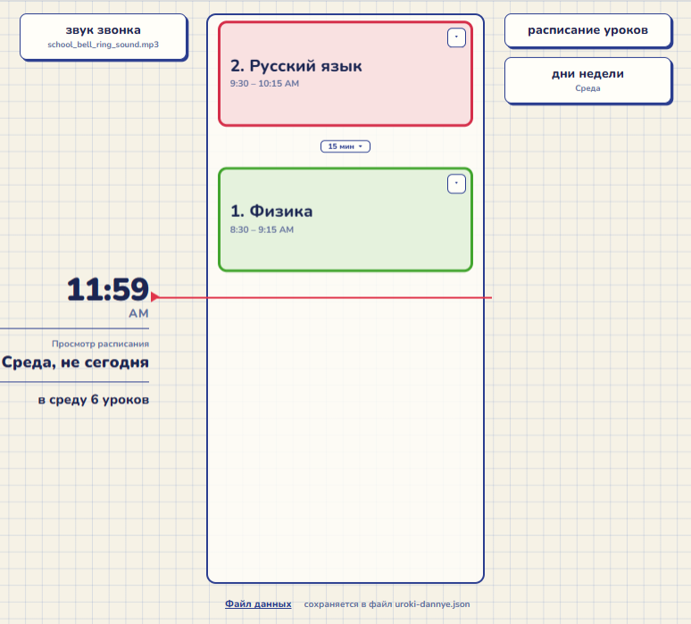

# Школьнй звонок

**Удобно для школьников на дистанционке и родителей**  
Простая браузерная программка с расписанием уроков, которую я сделал для своего сына.  
По умолчанию уже установлены предметы для 7 класса.  
🚀 Максимально просто и удобно. И никаких подписок, просто берите и пользуйтесь.  
✅ Живая лента уроков и перемен движется вниз, время до конца урока.  
✅ Своё расписание по дням недели и свой звук звонка.  
✅ Данные хранятся в файле на вашем компьютере.  
✅ Настраиваемая длительность перемен.  

⚙️ Чтобы пользоваться вам нужно скачать отсюда 1 файл:
- uroki.html
и открыть в браузере (проверено на goolge chrome, firefox)  
Файл данных можно сгенерировать самому. А звук звонка будет по умолчанию.  
Если вы хотите аутентичный школьный звонок, то скачайте файл:  
- school_bell_ring_sound.mp3  и выберите его через кнопку звонка в левом верхнем углу.

ВСЁ! Если есть предложения по доработке пишите в личку в фейсбуке. С ув. Алекс.

